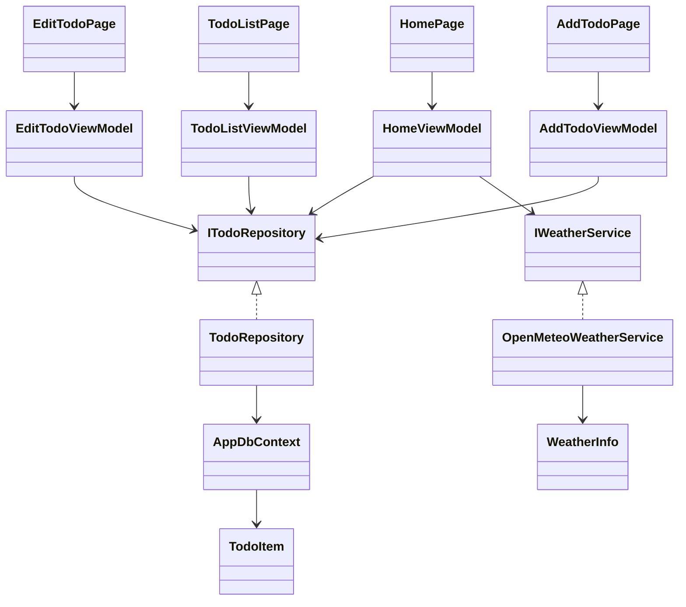

# LifeManagementApp

.NET 9 MAUI app that combines a todo list with the current weather in Vaasa and shows
"🪁 Kitesurf-keli!" when the wind is above 5 m/s.

- **Home**: top 3 unfinished todos (priority high → low, then earliest due date), temperature and wind (Open-Meteo, m/s), kitesurf notice.
- **Todos**: all todos in a CollectionView, sort by priority or due date, "Add todo" opens a form (empty title is not accepted). Tapping a todo opens the edit page (its id is passed as a Shell parameter) to edit, mark done or delete it.
- Todos are saved in SQLite with EF Core Code First.

## Run

```
git clone https://github.com/TreduChan/LifeManagementApp.git
cd LifeManagementApp
dotnet build LifeApp -f net9.0-windows10.0.19041.0 -t:Run
dotnet test Tests
```

Or open `LifeManagement.sln` in Visual Studio 2022 and start the Windows Machine target.

## Structure and class diagram

`Models/` data · `Converters/` priority colour · `Data/` DbContext · `Services/` database and weather · `ViewModels/` logic · `Views/` XAML pages · `MauiProgram.cs` DI · `Tests/` xUnit.



## Tekoälyn käyttö

Käytin Claude Codea koodin kirjoittamiseen vaihe kerrallaan, virheiden etsimiseen ja
selittämään, miksi asiat on tehty näin (MVVM, DI, EF Core, async). Kävin jokaisen muutoksen
läpi ja kirjoitin selitykset omaan muistiinpanodokumenttiin esittelyä varten.
